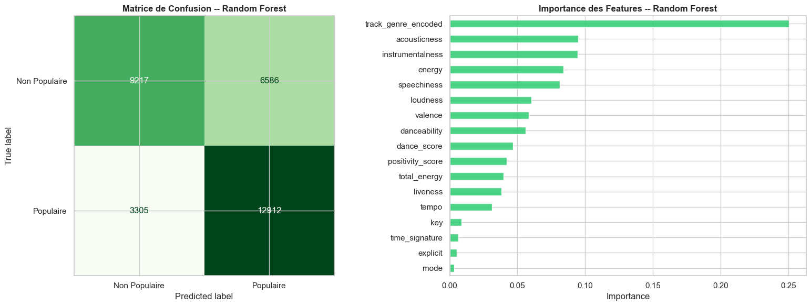
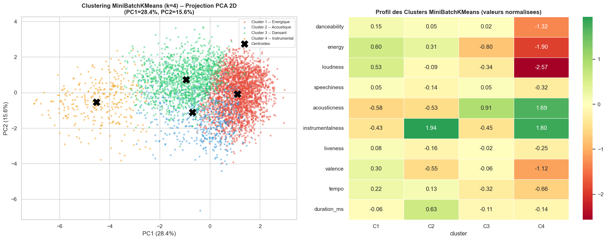

# Spotify Tracks: Data Mining & Machine Learning

A data mining project on ~114,000 Spotify tracks, following the **CRISP-DM** methodology. It looks for structure in the music catalogue (clustering, association rules) and tests how well audio features and genre predict whether a song is popular.

Course project for *Analyse et Fouille de Données* (class 2BD1), ISAMM, Université de la Manouba.
Authors: **Mohamed Kamel Bounouh** and **Mouhib Ben Nasr**. Supervisor: Dr. Nader Kolsi.

*(Le notebook et ses commentaires sont rédigés en français.)*

## What's in the notebook

| Step | What it does |
|------|--------------|
| Exploration | 114,200 rows and 21 columns; missing values, duplicates, distributions, correlations |
| Preprocessing | Drops ID/text columns, removes missing values and duplicates (106,732 rows left), encodes 114 genres, standardizes features |
| Feature engineering | `dance_score`, `energy_acoustic_ratio`, `duration_min`, `positivity_score`, tempo categories |
| Visualization | Univariate, bivariate and multivariate analysis (heatmaps, pair plot, 3D scatter, radar chart) |
| Unsupervised learning | K-Means (k=4), hierarchical clustering (CAH, Ward), Apriori association rules |
| Supervised learning | Linear regression (popularity score), Decision Tree and Random Forest (popular vs. not popular) |

## Main results

| Model | Task | Result |
|-------|------|--------|
| Linear regression | Predict popularity score | R² = 0.043 (RMSE 20.9) |
| Decision Tree | Popular vs. not popular | Accuracy 61.6%, AUC 0.661 |
| Random Forest | Popular vs. not popular | Accuracy 69.1%, AUC 0.762 (5-fold CV AUC 0.759 ± 0.012), F1 0.72 |

- **Audio features alone explain very little of popularity.** Linear regression explains only 4.3% of the variance.
- **Genre is the most important feature.** The Decision Tree splits on it first, and it has the highest importance in the Random Forest.
- **Clustering:** the elbow method and silhouette score pointed to k=4. The silhouette score is low (about 0.19), so the clusters overlap and should be read as rough groupings, not sharp categories.
- **Apriori:** 341 frequent itemsets and 2,002 rules. The strongest rules by lift link low energy, high acousticness and medium loudness.




## Method notes

- "Popular" means a popularity score above the **median of the training set** (37). The threshold and the scaler for the supervised models are computed after the train/test split, so test data does not leak into them.
- The 5-fold cross-validation is stratified.

## Limitations

- The binary "popular" label is a median split, so songs near the threshold are hard to classify by design.
- Genre is label-encoded as an integer, which suits tree models but not linear ones.
- Popularity is a snapshot from Spotify and depends on factors that are not in the data (artist fame, marketing, playlists).

## Run it

```bash
git clone https://github.com/kamel28617-del/spotify-data-mining.git
cd spotify-data-mining
python -m venv .venv
# Windows: .venv\Scripts\activate    macOS/Linux: source .venv/bin/activate
pip install -r requirements.txt
```

1. Download the **Spotify Tracks Dataset** from Kaggle (114,000 tracks, 21 columns).
2. Save it as `dataset.csv` in the repository root (it is not committed because of its size).
3. Run `jupyter notebook spotify_data_mining.ipynb`.

## Tech stack

Python, pandas, NumPy, Matplotlib, Seaborn, scikit-learn, SciPy, MLxtend.
